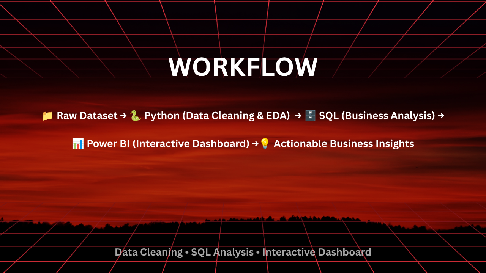

# 📊 Retail Sales Analytics

An end-to-end retail analytics project using Python, SQL, MySQL, and Power BI to explore sales performance, customer behavior, product profitability, and regional trends.

**Author:** Vibhor Jain  
**Domain:** Data Analytics | Business Intelligence

---

## 📊 Dashboard Preview

### Executive Dashboard


### Product and Customer Insights


### Regional and Geographic Insights


---

## 🎯 Project Overview

This project analyzes the Sample Superstore dataset to identify sales trends, evaluate profitability, understand customer purchasing behavior, and support data-driven business decisions.

The workflow covers data understanding, cleaning, exploratory data analysis, SQL-based business analysis, and interactive Power BI dashboard development.

## 🎯 Business Objectives

- Analyze sales and profit trends over time.
- Identify high-performing and loss-making products.
- Compare regional and category-level performance.
- Understand the relationship between discounts and profitability.
- Evaluate customer purchasing behavior.
- Present actionable insights through interactive dashboards.

## 🛠️ Technology Stack

| Tool | Purpose |
|---|---|
| Python | Data analysis and preprocessing |
| Pandas and NumPy | Data cleaning and manipulation |
| Matplotlib | Data visualization |
| SQL / MySQL | Business queries and analytical reporting |
| Power BI | Interactive dashboards |
| Jupyter Notebook | Exploratory analysis |
| Git and GitHub | Version control and project documentation |

## 📂 Project Files

### Python Notebooks
- `01_data_understanding.ipynb` — Inspect and understand the dataset.
- `02_data_cleaning.ipynb` — Clean and prepare the data.
- `03_eda.ipynb` — Perform exploratory data analysis.

### SQL Scripts
- `01_database_setup.sql` — Database setup.
- `02_basic_queries.sql` — Basic SQL analysis.
- `03_aggregation.sql` — Aggregation and KPI queries.
- `04_business_analysis.sql` — Business-focused analysis.
- `05_advanced_sql.sql` — Advanced SQL techniques.
- `06_interview_queries.sql` — Additional analytical practice queries.

### Data Files
- `sample_-_superstore.csv` — CSV dataset.
- `sample_-_superstore.xlsx` — Excel dataset.

### Dashboard and Visual Assets
- `Retails-sales-analytics.pbix` — Power BI report file.
- `Project_Banner.png` — Project banner.
- `Workflow.png` — Analytics workflow.
- `page1_dashboard.png` — Executive dashboard screenshot.
- `page2_dashboard.png` — Product and customer dashboard screenshot.
- `page3_dashboard.png` — Regional dashboard screenshot.

## 🔄 Project Workflow



1. Data understanding and validation
2. Data cleaning and preprocessing
3. Feature engineering, where applicable
4. Exploratory data analysis
5. SQL-based business analysis
6. Power BI dashboard development
7. Business interpretation and recommendations

## 🧹 Data Preparation

The data preparation stage covers checks for:

- Missing values and duplicate records
- Data types and date formats
- Column names and consistency
- Invalid or inconsistent values
- Suitability of fields for sales and profit analysis

The exact transformations are documented in the notebooks.

## 📈 Exploratory Data Analysis

The analysis explores:

- Sales and profit trends
- Regional performance
- Product category and sub-category performance
- Customer purchasing behavior
- Discount and profitability patterns
- Shipping performance

## 🗄️ SQL Business Analytics

The SQL scripts cover database setup, filtering, aggregations, business KPIs, and advanced analytical queries.

Advanced topics are included where implemented, such as joins, subqueries, common table expressions, and window functions.

## 📊 Power BI Dashboard

The Power BI report is designed to present business performance through visual summaries and interactive exploration.

Dashboard screenshots are included above. Open `Retails-sales-analytics.pbix` in Power BI Desktop to explore the report, subject to the availability of its data sources.

## 💡 Business Insights

The final insights should be based on the verified results of the Python notebooks, SQL queries, and Power BI report.

Document the most important findings here, including the relevant metric, comparison, and business implication.

## 🚀 Future Improvements

- Sales forecasting
- Customer segmentation and RFM analysis
- Automated data quality checks
- Additional KPI reporting
- Reproducible analysis and reporting

## ▶️ Getting Started

### 1. Clone the repository

```bash
git clone https://github.com/VibhorJain1108/retail-sales-analytics.git
cd retail-sales-analytics
```

### 2. Create a Python environment

```bash
python -m venv .venv
```

Activate it on Windows:

```bash
.venv\Scripts\activate
```

### 3. Install dependencies

```bash
python -m pip install -r requirements.txt
```

### 4. Run the notebooks

```bash
jupyter notebook
```

Open the notebooks in numerical order and follow their instructions.

### 5. Run the SQL scripts

Install and configure MySQL if required. Review the database setup script, configure the database and credentials locally, and execute the SQL scripts in the appropriate order.

### 6. Open the Power BI report

Open `Retails-sales-analytics.pbix` in Power BI Desktop. If prompted, configure the data source paths.

## 👨‍💻 Author

**Vibhor Jain**

Electronics & Communication Engineering  
Birla Institute of Technology, Mesra

- **GitHub:** [VibhorJain1108](https://github.com/VibhorJain1108)
- **LinkedIn:** [Vibhor Jain](https://www.linkedin.com/in/vibhorjain1108)
- **Email:** jainvibhu2004@gmail.com

---

If you find this project useful, feel free to explore the notebooks, SQL scripts, and dashboard.
