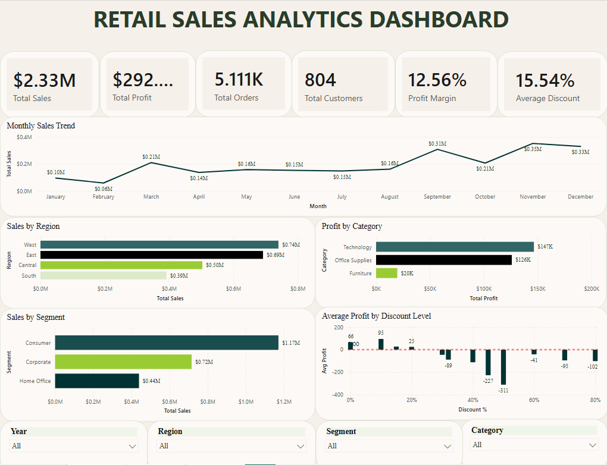
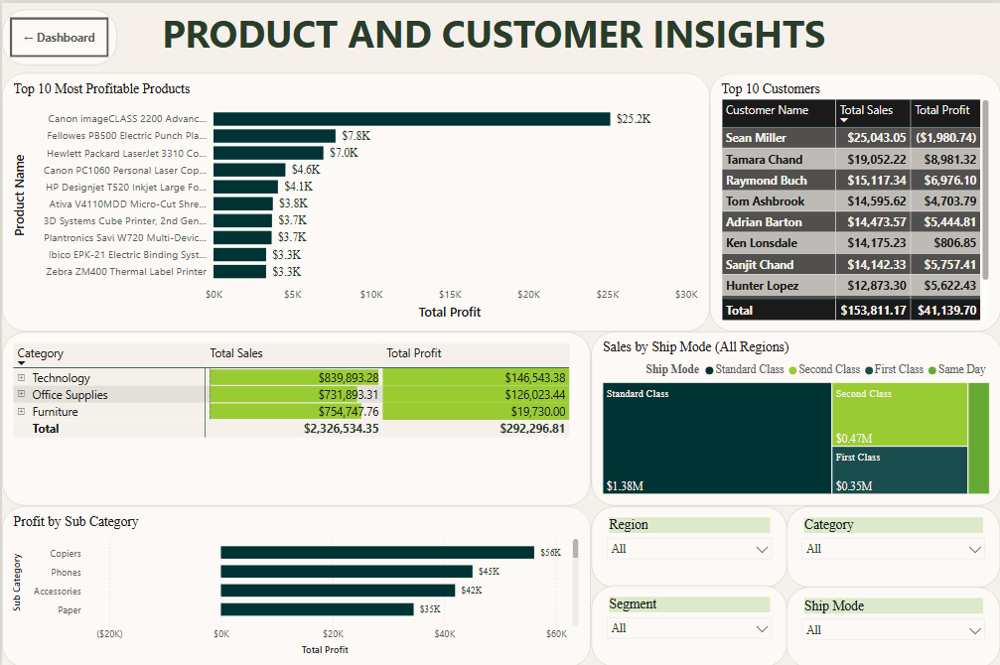
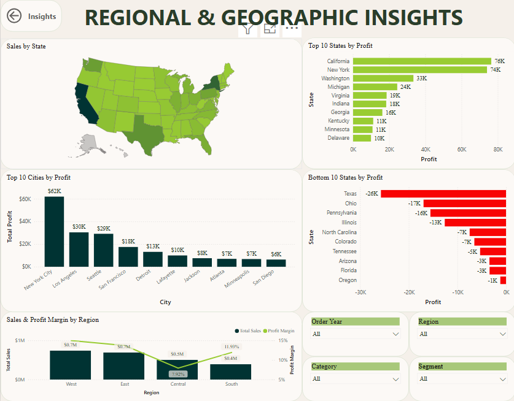

# 📊 Retail Sales Analytics

**End-to-end retail data analysis using Python, SQL, MySQL, and Power BI.**

This project analyzes the Sample Superstore dataset to explore sales performance, profitability, product trends, customer behavior, and regional performance. It combines Python notebooks, SQL queries, and Power BI dashboards to demonstrate a practical data analytics workflow.

## 📌 Project Overview

Retail businesses need reliable insights into sales, profits, products, and customer purchasing patterns. This project demonstrates how data can be explored, analyzed, and presented to support business decision-making.

### 🎯 Objectives

- Analyze sales and profit performance.
- Compare product categories and sub-categories.
- Explore regional sales and profitability.
- Investigate discount and profit relationships.
- Examine customer purchasing patterns.
- Present findings through Power BI dashboards.

## 🖥️ Dashboard Preview

### 1. Executive Dashboard



### 2. Product and Customer Insights



### 3. Regional and Geographic Insights



## 🛠️ Technology Stack

| Technology | Purpose |
|---|---|
| Python | Data analysis and preprocessing |
| Pandas and NumPy | Data manipulation |
| Matplotlib | Data visualization |
| SQL / MySQL | Database queries and business analysis |
| Power BI | Interactive dashboards |
| Jupyter Notebook | Exploratory data analysis |
| Git and GitHub | Version control |

## 📂 Repository Structure

```text
retail-sales-analytics/
├── 01_data_understanding.ipynb
├── 02_data_cleaning.ipynb
├── 03_eda.ipynb
├── 01_database_setup.sql
├── 02_basic_queries.sql
├── 03_aggregation.sql
├── 04_business_analysis.sql
├── 05_advanced_sql.sql
├── 06_interview_queries.sql
├── Retails-sales-analytics.pbix
├── Project_Banner.png
├── Workflow.png
├── page1_dashboard.png
├── page2_dashboard.png
├── page3_dashboard.png
├── sample_-_superstore.csv
├── sample_-_superstore.xlsx
├── requirements.txt
└── README.md
```

## 🔄 Project Workflow

1. **Data Understanding:** Inspect the dataset, columns, and data types.
2. **Data Cleaning:** Check data quality, missing values, and duplicates.
3. **Exploratory Data Analysis:** Explore sales, profit, products, and regional trends.
4. **SQL Analysis:** Use queries to investigate business questions and performance metrics.
5. **Dashboard Development:** Present analytical information using Power BI.
6. **Business Interpretation:** Derive recommendations from verified results.

## 🐍 Python Analysis

The project contains three Jupyter notebooks:

- `01_data_understanding.ipynb` — Initial dataset inspection.
- `02_data_cleaning.ipynb` — Data quality checks and preprocessing.
- `03_eda.ipynb` — Exploratory data analysis and visualizations.

## 🗄️ SQL Analysis

Six SQL scripts cover database setup and analytical queries:

- `01_database_setup.sql` — Database setup.
- `02_basic_queries.sql` — Basic queries and filtering.
- `03_aggregation.sql` — Aggregations and summary metrics.
- `04_business_analysis.sql` — Business-oriented queries.
- `05_advanced_sql.sql` — Advanced SQL analysis.
- `06_interview_queries.sql` — Additional analytical practice queries.

Review the database setup script and configure your database and table before running the queries.

## 📈 Power BI Dashboard

**Report:** `Retails-sales-analytics.pbix`

The report is designed to present retail performance through visual summaries and interactive exploration.

To open it:

1. Install Power BI Desktop.
2. Clone or download this repository.
3. Open the `.pbix` file.
4. Update the data source path if prompted.
5. Refresh the data if required.

## ⚙️ Getting Started

### Prerequisites

- Python 3
- Git
- Jupyter Notebook
- MySQL, for executing the SQL scripts
- Power BI Desktop, for viewing the report

### 1. Clone the repository

```bash
git clone https://github.com/VibhorJain1108/retail-sales-analytics.git
cd retail-sales-analytics
```

### 2. Create a virtual environment

```bash
python -m venv .venv
```

Activate it on Windows PowerShell:

```powershell
.\.venv\Scripts\Activate.ps1
```

On macOS or Linux:

```bash
source .venv/bin/activate
```

### 3. Install dependencies

```bash
python -m pip install -r requirements.txt
```

### 4. Launch Jupyter Notebook

```bash
jupyter notebook
```

Open the notebooks in numerical order.

### 5. Execute SQL scripts

Configure MySQL, create or import the required table, and review the database setup script before executing the analytical queries.

### 6. Open the Power BI report

Open `Retails-sales-analytics.pbix` in Power BI Desktop and configure its data source if necessary.

## 🚀 Future Improvements

- Document quantified business findings.
- Add sales forecasting.
- Explore customer segmentation and RFM analysis.
- Automate data quality checks.
- Improve dashboard interactivity and reporting.

## 👨‍💻 Author

**Vibhor Jain**

Electronics & Communication Engineering  
Birla Institute of Technology, Mesra

- GitHub: [VibhorJain1108](https://github.com/VibhorJain1108)

---

*This project demonstrates a practical workflow for retail data analysis, SQL querying, and business intelligence reporting.*
